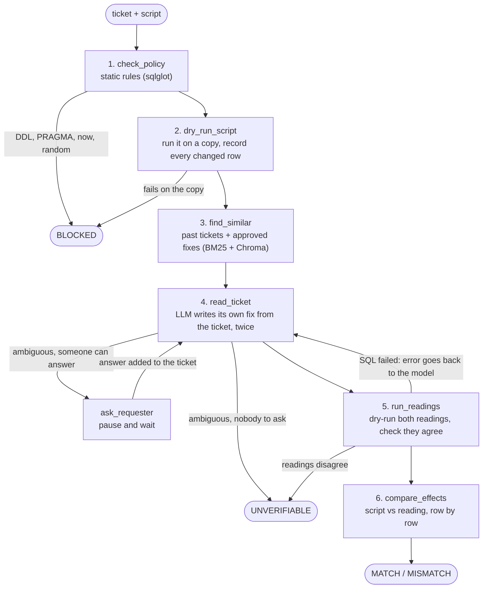

# IntentDiff

**Catches database fix scripts that don't do what the ticket asked for - before they run on production.**

IntentDiff dry-runs a data-fix script on a copy of the database and records every row and column it changes.
Separately, an LLM reads only the ticket (never the script) and writes its own version of the fix, which is
dry-run the same way. Plain code then compares the two effects row by row and reports extra rows, missing rows
and wrong values. The LLM never decides the verdict.

Around that core:

- a **LangGraph** workflow that sends failing SQL back to the model with the error, and pauses to ask the
  requester when a ticket is ambiguous (the paused review is saved and survives a restart)
- **hybrid retrieval (BM25 + Chroma)** over past tickets and their approved fixes, so the model follows the
  team's conventions
- an **MCP server**, so AI coding agents (Claude Code, Cursor, ...) can check a fix before they run it
- a **GitHub Action** that checks every fix script in a pull request and comments the verdict

Built with Python, SQLite, sqlglot, Gemini, Pydantic, LangGraph, Chroma, rank-bm25, MCP, FastAPI and Docker.

---

## The problem

In most companies that run their own databases - banks especially - production data is corrected through
tickets: someone asks for a change ("client 2045's email is wrong, please update it"), an engineer writes an
`UPDATE`/`DELETE` script, and someone reviews and approves it before it runs.

That review usually checks whether the SQL *looks* safe. Is there a `WHERE` clause? Is it the right table? What
it rarely checks is whether the rows the script will actually change are the rows the ticket asked for. A
script with a typo in an ID, a `<` that should be `<=`, or a forgotten condition looks perfectly normal and
still damages data.

That's what happened in [Atlassian's April 2022 outage](https://www.atlassian.com/blog/atlassian-engineering/post-incident-review-april-2022-outage):
a cleanup script was given the IDs of whole customer sites instead of the IDs of an app. The review checked
how the script would run, but not which IDs it would delete. 775 customers lost access, some of them for up to
two weeks.

The problem is growing because AI agents now write and run SQL too. In July 2025 an AI coding agent
[deleted a live production database](https://www.theregister.com/2025/07/21/replit_saastr_vibe_coding_incident/)
during a code freeze.

Existing tools cover pieces of this:

| Approach | Catches | Misses |
|---|---|---|
| Peer review by eye | obvious mistakes | wrong IDs or conditions that look plausible |
| SQL linters / review rules | missing `WHERE`, `DROP`, anti-patterns | a well-written script that hits the wrong rows |
| Affected-row limits | huge accidental changes | the wrong rows, in the right number |
| Dry run + diff | shows what the script changes | doesn't know what *should* change |
| "Run a `SELECT` first" | count sanity | the `SELECT` reuses the script's own `WHERE`, so it has the same bug |
| Asking an LLM "does this match?" | some logic errors | can't see the data, gets anchored by the script |
| Self-correcting text-to-SQL | SQL that crashes | SQL that runs fine and does the wrong thing |

IntentDiff combines a dry-run diff with an **independent** reading of the ticket, and compares the two on their
actual effect on the data.

## How it works

The check is a [LangGraph](https://github.com/langchain-ai/langgraph) workflow ([graph.py](intentdiff/graph.py)):



1. **Static check.** The script is parsed with sqlglot. Only data changes (`UPDATE`, `DELETE`, `INSERT`) are
   allowed, plus harmless `SELECT`/`BEGIN`/`COMMIT`. Anything that isn't repeatable (`date('now')`, `random()`)
   is blocked, because a dry run of it wouldn't predict the real effect.
2. **Dry run.** The script runs on a throwaway copy of the database, with foreign keys on and a SQLite
   authorizer that refuses `ATTACH`, `PRAGMA`, DDL and so on, even if something got past step 1. The copy is
   then diffed against the original by primary key, which gives every inserted, deleted and updated row with
   before/after values.
3. **Similar past tickets.** The three most similar tickets from the team's history are looked up, with the
   fixes that were approved for them. See [Retrieval](#retrieval-learning-from-past-tickets).
4. **Reading the ticket.** An LLM gets the ticket, the schema and those examples, but **not the script**, and
   returns a structured answer (a Pydantic model): a reference SQL fix, the columns the ticket specifies, IDs
   quoted from the ticket, and any open questions. It is asked twice, with differently worded prompts. Its
   output is checked in code: the SQL must pass the same policy, the columns must exist, and every "quoted" ID
   must really appear in the ticket, so the model can't invent one.
5. **Reference dry runs.** Each reading is dry-run on its own copy. If its SQL fails there, the model gets the
   error back and another try (three in total). If the two readings change different rows, the ticket can
   probably be read more than one way, and the review is escalated.
6. **Comparison.** The script's effect is compared with the reference effect: rows the ticket doesn't ask for,
   rows it asks for that the script doesn't touch, wrong values in the columns the ticket specifies, and extra
   columns changed.

### Verdicts

| Verdict | Meaning | What happens next |
|---|---|---|
| `MATCH` | the script changes exactly what the ticket asks for | one approver signs off |
| `MISMATCH` | it changes something else - the report lists every difference | back to the author; overriding needs a written reason |
| `UNVERIFIABLE` | ambiguous ticket, readings disagree, or the LLM failed | ask the requester / senior review |
| `BLOCKED` | breaks the policy, or fails on the copy (e.g. a foreign key) | not approvable |

The workflow **fails closed**: if the LLM times out, returns garbage or can't be reached, the verdict is
`UNVERIFIABLE`, never `MATCH`.

### Why the LLM never sees the script

If the model reads the script, it tends to accept the script's interpretation, including its bugs. Keeping the
two derivations independent is the same idea as differential testing: two separate implementations of the same
request, compared on their outputs. It isn't a guarantee - two independent readers can make the same mistake
on a badly written ticket - which is why the two-readings check and the questions for the requester exist.

### Why a fixed workflow and not a free agent

The steps are always the same, and the verdict has to be reproducible and explainable to an auditor. An agent
that decides on its own which steps to run would add randomness and new ways to fail. So the graph's edges are
fixed: LangGraph is used for the two loops (retry, ask the requester) and for saving a paused review, not for
letting the model choose what to do next. The model also has no tools - the only thing it ever produces is a
reference fix.

## Retrieval: learning from past tickets

[data/ticket_history.yaml](data/ticket_history.yaml) holds 30 past tickets with the scripts that were approved
for them. For every new ticket the three most similar ones are shown to the model as worked examples. They
teach it the team's habits, the things a schema can't say:

- closing an account also sets `closed_on`
- "remove the phone number" means `NULL`, not an empty string
- "from 1996-08-01 to 1996-12-31" includes both days
- "the account holder" means the `owner` in `disp`, not any user

Search is **hybrid**, because each half finds things the other misses ([history.py](intentdiff/history.py)):

- **BM25** (keywords) is good at exact words: `running_in_debt`, `standing order`, column names.
- **Chroma** with a small embedding model (all-MiniLM-L6-v2) is good at meaning. For "The customer wants to
  shut down their account" it ranks "close account 2244" first, while BM25 alone puts an unrelated ticket about
  withdrawn consent on top.

The two rankings are merged with **reciprocal rank fusion**: each list gives a ticket `1 / (60 + rank)` and the
scores are added up.

A few deliberate choices:

- **The schema isn't retrieved.** It's small enough to send whole, and leaving out a table would be worse than
  a longer prompt. Retrieval is for the part that keeps growing: ticket history.
- **No answer leaks.** The history was written separately from the benchmark and doesn't reuse its IDs or
  values. A test checks that no history ticket or fix appears in the benchmark.
- **Examples can also mislead** - the model might copy an old ticket instead of reading the new one. That's why
  retrieval has its own ablation in the evaluation (`intentdiff` vs `intentdiff-norag`).
- **Retrieval never decides anything.** If the embedding model can't be loaded, search falls back to BM25 alone
  and the check carries on.

## Self-correction and asking the requester

Two loops in the graph:

- **The model's SQL fails on the copy** (a foreign key, a typo in a column): the error goes back into the
  prompt and the ticket is read again, at most three times. After that the review ends as `UNVERIFIABLE`.
  Nothing is retried for the engineer's script - if *that* fails, it's `BLOCKED`.
- **The ticket is ambiguous** ("extend loan 4967" - by how much?): in the web app the review pauses and shows
  the model's questions. Whoever handles the ticket asks the requester and types the answer, and the review
  continues from where it stopped, with the answer added to the ticket. The paused state is saved by LangGraph's
  SQLite checkpointer, so it can wait for days and survives a server restart. Everywhere else (command line,
  PR check, MCP) nobody can answer on the spot, so an ambiguous ticket simply ends as `UNVERIFIABLE`.

## For AI agents: the MCP server

```bash
python -m intentdiff.mcp_server
```

Starts an [MCP](https://modelcontextprotocol.io) server over stdio with three read-only tools:

| Tool | What it does |
|---|---|
| `check_data_fix(ticket, sql)` | the full check: verdict, reasons and every difference |
| `preview_effect(sql)` | which rows a script would change - no LLM involved |
| `describe_schema()` | tables, columns and allowed values |

To add it to Claude Code (run from the project folder, with the virtual environment active):

```bash
claude mcp add --transport stdio intentdiff --env GEMINI_API_KEY=your-key -- python -m intentdiff.mcp_server
```

Other clients (Cursor, Claude Desktop, ...) take the same command in their MCP settings.

The agent gets a verdict, never the power to approve. The server's instructions tell it to run a script only
after a `MATCH` and a human approval, and to pass `UNVERIFIABLE` questions on to its user instead of answering
them itself. It also never sees the model's reference SQL - if it could copy that, the two independent versions
of the fix would quietly become one.

## In a pull request: the GitHub Action

Fixes are reviewed like code. A pull request adds two files to [fixes/](fixes/):

```
fixes/INC-2031.txt    the ticket, copied from the ticketing system
fixes/INC-2031.sql    the script that should carry it out
```

[check-fixes.yml](.github/workflows/check-fixes.yml) builds the database (cached between runs), checks every
fix that changed, posts the report as a PR comment, and fails unless every verdict is `MATCH`. It needs one
repository secret, `GEMINI_API_KEY`. A `MATCH` still needs a person to approve the PR.

## Getting started

Requires Python 3.11+. Commands are shown for Windows PowerShell; where Mac/Linux differs, it's in the comment.

```bash
python -m venv .venv
.venv\Scripts\activate             # Mac/Linux: source .venv/bin/activate
pip install -r requirements.txt
```

**1. Get the data.** The project uses the [PKDD'99 "Berka" dataset](https://github.com/jlacko/berka-dataset):
real, anonymised data from a Czech bank (4,500 accounts, 5,369 clients, about 1.06 million transactions,
1993-1998).

```bash
python scripts/download_data.py    # ~70 MB into data/raw/
python scripts/build_db.py         # builds data/bank.db, about 25 seconds
```

The loader translates the Czech codes to English, converts dates to ISO format and decodes gender from the birth
number. It also adds a few columns that data-fix tickets usually touch but the original data doesn't have
(`client.email`, `client.phone`, `account.status`, `account.closed_on`). These are generated with a fixed seed
and marked as synthetic in [data/schema.sql](data/schema.sql).

**2. Run the tests.** They use a tiny built-in database, a fake LLM and fake embeddings, so they need no data,
no key and no downloads:

```bash
pytest
```

**3. Set a Gemini API key** (free from [Google AI Studio](https://aistudio.google.com/apikey)). Everything except
the ticket reading works without one.

```bash
$env:GEMINI_API_KEY = "your-key"           # bash/zsh: export GEMINI_API_KEY=your-key
$env:INTENTDIFF_MODEL = "gemini-3.8-flash" # optional, this is the default
```

The first run downloads Chroma's embedding model (about 80 MB) once.

**4. Use it.**

```bash
# just show what a script would change - no LLM involved
python -m intentdiff effect --sql fixes/INC-2031.sql

# full check; exits with code 1 unless the verdict is MATCH, so it can gate a pipeline
python -m intentdiff check --ticket fixes/INC-2031.txt --sql fixes/INC-2031.sql

# web page + API on http://127.0.0.1:8000 (API docs at /docs)
uvicorn app.server:app --reload
```

The web page has every benchmark ticket preloaded with its correct script, known mistakes and mutations, so you
can try the check without writing anything. The API stores every review with hashes of the ticket, the script and
the database file. An approval must include the hash of the script being approved, so a script edited after its
review can't ride on the old approval.

**Docker:**

```bash
docker build -t intentdiff .
docker run -p 8000:8000 -e GEMINI_API_KEY=your-key intentdiff
```

The image downloads the data and builds the database at build time. It reads `PORT` from the environment, so it
runs as is on Render or any other host that sets one.

## Evaluation

### How cases are built and labelled

[eval/tickets.yaml](eval/tickets.yaml) holds realistic change tickets across 14 categories: single IDs, ID lists,
condition-based bulk changes, relative changes ("extend by 12 months"), joins, deletes, exclusions, date
boundaries, NULL handling, multi-statement fixes, inserts, no-op tickets, ambiguous tickets and tickets that
contain prompt-injection text. Each ticket has a correct **gold** script, checked against the real data.

From every gold script the evaluator generates variants:

- **rewrites** - different SQL with the same effect, to measure false alarms
- **known mistakes** - hand-written bugs such as `email = NULL` or unpadded dates (`'1997-1-1'`)
- **mutants** - one small change each, using operators adapted from SQL mutation testing
  ([Tuya et al., 2007](https://files01.core.ac.uk/download/pdf/71870666.pdf)): wrong ID, swapped digits,
  `<` vs `<=`, `BETWEEN` turned into an exclusive range, `AND` -> `OR`, a dropped condition, a dropped `WHERE`,
  a dropped list item, a changed value

**Every case is labelled by execution.** A variant counts as correct only if its effect on the database is
identical to the gold script's effect. Nobody, human or model, labels cases by reading SQL. This also handles the
classic "equivalent mutant" problem: some mutants happen to change exactly the same rows on this data, and they
are labelled as correct.

### Reviewers compared

| ID | Reviewer | Uses AI |
|---|---|---|
| B0 | static lint (policy + `UPDATE`/`DELETE` without `WHERE`) | no |
| B1 | B0 + dry run, flag anything over 100 rows | no |
| B2 | B1 + IDs pulled from the ticket with a regex must match the changed rows | no |
| B3 | LLM sees ticket + script and gives a verdict, nothing executed | yes |
| IntentDiff | the full workflow | yes |
| IntentDiff, no retrieval | the full workflow without the past-ticket examples | yes |

B2 is the bar to beat: it's what a careful team could put together in an afternoon.

### Results so far

Starter benchmark: 29 tickets -> **200 cases** (42 correct scripts, 155 wrong ones, 3 ambiguous tickets;
9 mutants turned out to be equivalent). Run on 19 October 2026 with `python -m eval.run_eval --systems b0,b1,b2`.
Brackets are 95% Wilson intervals.

| Reviewer | Unsafe passes (wrong script approved) | False alarms (correct script flagged) | Ambiguous tickets escalated |
|---|---|---|---|
| B0 lint | 128/155 (83%) [76-88%] | 0/42 (0%) | 0/3 |
| B1 + row limit | 100/155 (65%) [57-72%] | 0/42 (0%) | 0/3 |
| B2 + ticket IDs | 54/155 (35%) [28-43%] | 8/42 (19%) [10-33%] | 0/3 |
| B3 LLM only | *not run yet* | | |
| IntentDiff | *not run yet* | | |
| IntentDiff, no retrieval | *not run yet* | | |

Even the best non-AI reviewer approves about a third of the wrong scripts, and it is weakest exactly where the
ticket describes rows by conditions instead of IDs (date boundaries 7/14 unsafe, conditions 9/15,
multi-statement fixes 9/17). That is the gap IntentDiff is meant to close. The full per-category breakdown is in
[eval/results/](eval/results/).

The AI reviewers need an API key:

```bash
python -m eval.run_eval --systems b2,b3,intentdiff,intentdiff-norag --split dev    # tune on dev
python -m eval.run_eval --systems b2,b3,intentdiff,intentdiff-norag --split test   # report on test
```

The whole benchmark takes roughly 320 model calls (about half a million input tokens). Gemini's free tier allows
only 20 requests per day per model, so a full run needs a key with billing enabled. If any call fails (quota,
network), the run's summary says it is **not valid** - an API error turns into `UNVERIFIABLE`, which is the safe
answer in production but would quietly distort the numbers. Run it again: LLM responses are cached in
`.cache/llm/`, so only the failed calls are repeated, and a re-run gives identical answers.

### Metrics

- **Unsafe-pass rate** - wrong scripts given `MATCH`. The number that matters most.
- **False-alarm rate** - correct scripts flagged as `MISMATCH` or `BLOCKED`.
- **Clean-pass rate** - correct scripts given `MATCH`, i.e. how much review work is actually saved.
- **Escalation rate** - `UNVERIFIABLE` results, overall and on the ambiguous tickets (where escalating is the
  right answer).
- **Per-category breakdown** - to show where the LLM helps and where it adds nothing.
- Time per review and token usage are logged per run.

## Security notes

- **Both the script and the model's SQL are untrusted.** Both go through the same policy check, run only on
  throwaway copies, and run under a SQLite authorizer that allows nothing but reads, data changes and
  transactions. Dry runs have a timeout.
- **Prompt injection.** Ticket text is data. The model has no tools and no say over the verdict, so the worst an
  injected instruction can do is distort the reference fix, which shows up as `MISMATCH` or `UNVERIFIABLE`, not
  as a silent pass. The benchmark includes injection tickets to measure this.
- **Agents can't approve.** The MCP tools are read-only and only return a verdict. Approvals go through the web
  app or the PR, and are tied to the script's hash.
- **Privacy.** The model sees the ticket text, the schema and past tickets. It never sees rows from the database.

## Limitations

- **SQLite only.** Oracle, SQL Server and Postgres differ in typing, date handling and locking. The dry-run idea
  carries over (run in a transaction on a clone, then roll back), but this code doesn't.
- **A snapshot is not live production.** The data can change between the dry run and the real run. Each review
  records the hash of the database file it ran against, but nothing re-checks right before execution.
- **Matching effects on today's data is not proof of correctness in general.** A script with an unbounded date
  condition can be right today and wrong next month.
- **The benchmark is small** and the tickets are written in a fairly clean, templated style. A held-out set
  written by other people, in their own words, is still needed before trusting the numbers.
- **The ticket history is hand-written** and small (30 tickets). A real team would load it from its ticketing
  system, and would have to keep wrong fixes out of it.
- **Through MCP the agent supplies the ticket text.** In production the server should fetch the ticket from the
  ticketing system by ID, so an agent can't "clarify" it on its own.
- **One schema.** Prompts and notes may be tuned to this bank schema without anyone noticing.
- Copying the database for every dry run is fine at ~90 MB, but not at production sizes.

## Future work

- Run B3 and IntentDiff (with and without retrieval) on the benchmark and report dev/test results with
  confidence intervals.
- Collect 30-40 held-out tickets written by other people.
- More ablations: one reading vs two, letting the model see the script (does it get anchored?), a smaller vs a
  larger model.
- A second schema (e.g. Chinook) to check that nothing is tuned to this one dataset.
- Capture changes with temporary triggers inside a rolled-back transaction instead of copying the file.
- Postgres support, and a re-check right before execution to close the snapshot gap.
- A local model option (e.g. through Ollama) for teams that can't send ticket text to an external API.
- Fetch tickets from Jira / ServiceNow by ID, for the PR check and the MCP server.

## Project structure

```
intentdiff/
├── intentdiff/              core library
│   ├── policy.py            static SQL checks (sqlglot)
│   ├── dryrun.py            sandboxed execution on a DB copy + row-level diff
│   ├── changes.py           ChangeSet, effect comparison
│   ├── intent.py            prompt, IntentSpec schema, validation of the LLM output
│   ├── history.py           past tickets + hybrid search (BM25, Chroma, RRF)
│   ├── graph.py             the LangGraph workflow: nodes, loops, checkpointer
│   ├── review.py            the Review result, verdicts and reports
│   ├── llm.py               Gemini client with a disk cache
│   ├── baselines.py         B0-B3 reviewers used for comparison
│   ├── schema.py            reads tables/keys/foreign keys from the DB
│   ├── mcp_server.py        MCP tools for AI agents
│   └── __main__.py          command line
├── app/
│   ├── server.py            FastAPI: JSON API, review store, approvals, demo page
│   └── templates/           the demo page
├── eval/
│   ├── tickets.yaml         benchmark tickets
│   ├── mutate.py            SQL mutation operators
│   ├── run_eval.py          builds cases, labels them by execution, scores every reviewer
│   └── results/             saved runs (cases.jsonl + summary.md)
├── data/
│   ├── schema.sql           bank schema (translated Berka dataset)
│   ├── schema_notes.yaml    column descriptions given to the LLM
│   └── ticket_history.yaml  past tickets and their approved fixes (retrieval)
├── fixes/                   data fixes reviewed through pull requests
├── scripts/
│   ├── download_data.py     fetches the raw Berka files
│   ├── build_db.py          builds data/bank.db from them
│   └── check_pr_fixes.py    used by the GitHub Action
├── docs/architecture.md     how the pieces fit together
├── .github/workflows/       tests + the PR check
├── Dockerfile
└── tests/                   pytest suite
```

More detail on the design is in [docs/architecture.md](docs/architecture.md).

## Data and credits

- PKDD'99 Discovery Challenge financial dataset, prepared by Petr Berka and Marta Sochorova. Raw files from
  [jlacko/berka-dataset](https://github.com/jlacko/berka-dataset). The raw files and the built database are not
  committed to this repository.
- SQL mutation operators adapted from Tuya, Suarez-Cabal and de la Riva, "Mutating database queries",
  *Information and Software Technology*, 2007.
- Reciprocal rank fusion from Cormack, Clarke and Buettcher, "Reciprocal Rank Fusion outperforms Condorcet and
  individual Rank Learning Methods", SIGIR 2009.
