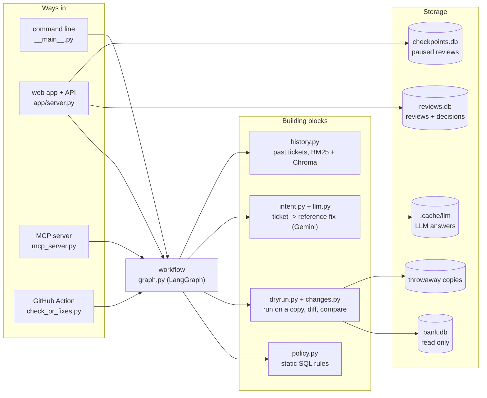
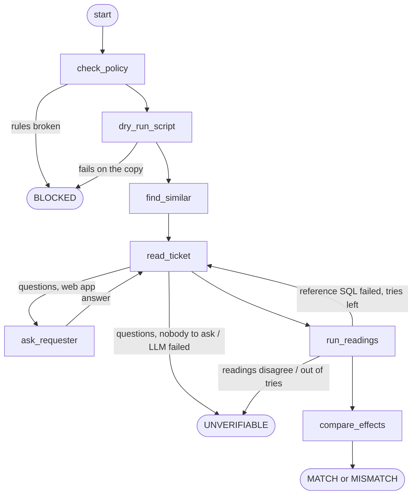
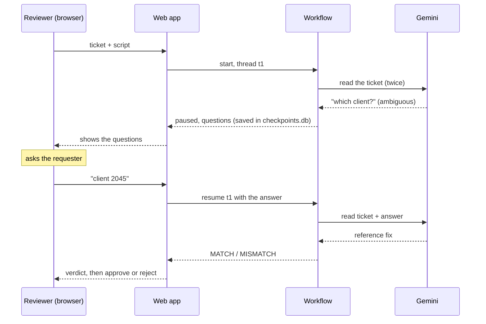

# Architecture

This page explains how IntentDiff is put together: the parts, how a check flows through them, where each
decision is made, and what happens when something fails. The [README](../README.md) covers what the project
does and how to run it.

## The big picture

All four ways in run the same workflow. They differ only in what they do with the result:

| Way in | Who uses it | Can pause for the requester? | Where the result goes |
|---|---|---|---|
| `python -m intentdiff check` | an engineer, a pre-execution hook | no | terminal, exit code |
| web app / API | the reviewer of a ticket | yes | page or JSON, stored in `reviews.db` |
| MCP server | an AI coding agent | no | tool result for the agent |
| GitHub Action | a pull request that adds `fixes/*.sql` | no | PR comment, red or green check |

## Modules

| Module | Job | Uses an LLM? |
|---|---|---|
| `policy.py` | parses SQL with sqlglot and applies the rules: data changes only, nothing time- or random-dependent, known tables | no |
| `dryrun.py` | copies the database, runs SQL on the copy under a SQLite authorizer and a timeout, diffs the copy against the original by primary key | no |
| `changes.py` | `ChangeSet` (what a script did, row by row) and `compare()` (how two effects differ) | no |
| `intent.py` | the prompt, the `IntentSpec` Pydantic model, and the checks on what the model returns | builds the prompt |
| `llm.py` | Gemini client: JSON output, retries on network errors, disk cache | yes |
| `history.py` | past tickets, BM25 and Chroma indexes, reciprocal rank fusion | no (small local embedding model) |
| `graph.py` | the LangGraph workflow: nodes, routing, the checkpointer | calls `intent.py` |
| `review.py` | the `Review` result, verdict names, text and Markdown reports | no |
| `baselines.py` | simpler reviewers B0-B3 for the evaluation | B3 only |

## The workflow

The edges are fixed. No node asks the model what to do next.

### State

LangGraph passes one state object from node to node. It's a plain dict:

| Field | What it holds |
|---|---|
| `review` | the `Review` being filled in: ticket, script, both effects, readings, issues, verdict |
| `examples` | the past tickets found by `find_similar` |
| `feedback` | why the last reading was thrown away, e.g. the SQLite error; sent back to the model |
| `attempts` | how many times the ticket has been read in this round |
| `questions` | the model's open questions for the requester |

### Nodes

| Node | Does | Can end the review with |
|---|---|---|
| `check_policy` | static rules on the engineer's script | `BLOCKED` |
| `dry_run_script` | runs the script on a copy, records every changed row; warns above 1,000 rows | `BLOCKED` |
| `find_similar` | hybrid search over past tickets (skipped when no history is given) | - |
| `read_ticket` | asks the model for two independent readings; checks quoted IDs, columns and SQL policy | `UNVERIFIABLE` |
| `ask_requester` | `interrupt()`: saves the run and waits for an answer, then adds it to the ticket | - |
| `run_readings` | dry-runs each reading; checks a stated row count; checks the two readings agree | `UNVERIFIABLE`, or back to `read_ticket` |
| `compare_effects` | compares the script's effect with the reading's, row by row | `MATCH`, `MISMATCH`, `UNVERIFIABLE` (both too big to compare) |

### The two loops

**Retry with the error.** If a reading's SQL fails on the copy, `run_readings` puts the error in `feedback` and
routes back to `read_ticket`. The prompt then says what went wrong, and the model gets another go. After
`MAX_READ_ATTEMPTS` (3) readings the review ends as `UNVERIFIABLE`. The engineer's script never gets this
treatment: if it fails on the copy, that's the answer (`BLOCKED`).

**Ask the requester.** Only the web app builds the graph with `ask_requester=True`. Then an ambiguous ticket
goes to `ask_requester`, which calls LangGraph's `interrupt()`. The run is saved in `checkpoints.db` under a
thread id and the request returns. When someone submits an answer, the app resumes the same thread with
`Command(resume=answer)`; the answer is added to the ticket text and the ticket is read again. A review can go
back to the requester at most `MAX_QUESTION_ROUNDS` (2) times.

## Where each decision is made

The one rule of the design: **the model proposes, code decides.**

| Decision | Made by |
|---|---|
| Is the script allowed at all? | `policy.py` (sqlglot) and SQLite's authorizer |
| What does the script change? | SQLite, on a copy |
| What does the ticket ask for? | the model, twice, independently - and it never sees the script |
| Did the model invent an ID or a column? | `validate_spec()` in `intent.py` |
| Is the ticket ambiguous? | the model raises questions; two readings that disagree also count |
| Do script and ticket match? | `compare()` in `changes.py` |
| Verdict | the graph's nodes - plain `if` statements |
| Approval | a person, tied to the script's hash |

Everything that comes from outside is untrusted: the ticket (it can contain prompt injection), the script, and
the model's SQL. They all go through the same policy check and only ever run on throwaway copies. The model has
no tools, so injected text can at worst produce a wrong reference fix - which surfaces as `MISMATCH` or
`UNVERIFIABLE`, never as a silent pass.

## Retrieval

`TicketHistory` loads `data/ticket_history.yaml` once and builds two indexes in memory:

- **BM25** (`rank_bm25`) over the ticket texts, lowercased and split into words. `running_in_debt` and
  `standing_order` stay one word.
- **Chroma**, in-memory, with Chroma's default embedding model (all-MiniLM-L6-v2, run locally with ONNX).

`search()` takes the top 10 from each, merges them with reciprocal rank fusion (each list gives an item
`1 / (60 + rank)`), and returns the top 3. Those go into the prompt as "Past ticket H05: ... Approved fix: ...".

If Chroma or its model can't be loaded, a warning is logged and search runs on BM25 alone. That's safe because
retrieval only adds examples to the prompt - it never decides anything. `/health` shows which mode is active.

## Storage

| What | Where | Lifetime | In git? |
|---|---|---|---|
| bank data | `data/bank.db` | built once from the raw files, never written to | no |
| dry-run copies | system temp folder | deleted right after each dry run | no |
| reviews and decisions | `data/reviews.db` | append-only; decisions are never updated or deleted | no |
| paused reviews | `data/checkpoints.db` | until the review is resumed | no |
| LLM answers | `.cache/llm/` | keyed by a hash of model + prompt; makes benchmark re-runs free and repeatable | no |
| past tickets | `data/ticket_history.yaml` | edited by hand | yes |

## When things go wrong

| What fails | Result |
|---|---|
| script breaks a rule, or fails on the copy | `BLOCKED` |
| no API key, network error, rate limit, garbage JSON | `UNVERIFIABLE` (network errors and bad JSON get one retry first) |
| model quotes an ID that isn't in the ticket | answer rejected, model asked again; then `UNVERIFIABLE` |
| model's SQL fails on the copy | error sent back, up to 3 tries; then `UNVERIFIABLE` |
| two readings disagree | `UNVERIFIABLE` |
| both script and reading change too many rows to compare | `UNVERIFIABLE` |
| embedding model unavailable | keyword search only; the check carries on |
| dry run takes too long | stopped after 15 s; `BLOCKED` for the script, `UNVERIFIABLE` for a reading |

Nothing on this list can turn into a `MATCH`.

## Extending it

- **Another LLM.** Anything with a `generate_json(prompt, schema)` method that returns JSON text works - see
  `FakeLLM` in `tests/conftest.py` for the smallest example.
- **Another database engine.** `dryrun.py` is the only module that executes SQL. For Postgres, run the script in
  a transaction on a clone and roll back; `policy.py` would need the matching sqlglot dialect.
- **Real tickets.** `check_pr_fixes.py` and the MCP server take ticket text directly. In production they should
  fetch it from Jira or ServiceNow by ID instead, so nobody can rewrite a ticket on the way in.
